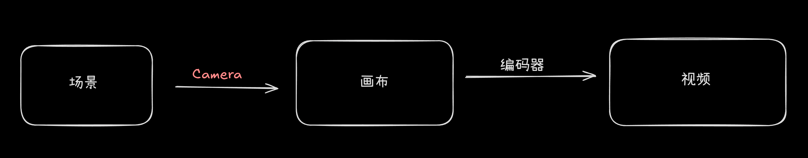

# xII::Camera
`Camera`是**xII**一个重要的角色，我们需要使用`Camera`才能进行绘制  
  
> 一般地，我们可以将`Camera`理解为是传感器  
> 但不同的是`Camera`负责调用`Item`进行渲染
# xII::Camera::Base
该class定义于`src/Camera/Base.h`
## 元素
### _shape *(private)*
这是其捕获窗口  
```C++
Item::Shape::Rectangle _shape;
```
### _screen *(private)*
其输出荧幕
```C++
std::shared_ptr<Screen::Screen> _screen;
```
### _object
捕获的根对象
```C++
std::shared_ptr<Item::Base> _object;
```
### _time_point
时间
```C++
std::shared_ptr<Time::OffsetPoint> _time_point;
```
### 构建 析构
```C++
Base(const Item::Shape::Rectangle& shape, 
     const Screen::PoSize& screen_size, 
     const std::shared_ptr<Item::Base>& object, 
     const std::shared_ptr<Time::OffsetPoint>& time_point)
  : _shape(shape),
    _object(object),
    _time_point(time_point)
    { _screen = std::make_shared<Screen::Screen>(screen_size); }
```
### Shoot()
该函数用于渲染目标  
```C++
virtual void Shoot() = 0;
```