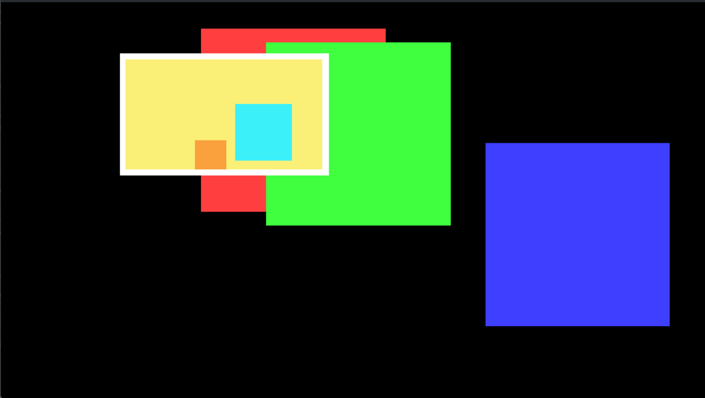

# xII::Camera::Standard
该class定义于`src/Camera/Standard.h`, 派生自`xII::Camera::Base`  
该`class`用于普通渲染  

## 使用
### 构建
使用前我们需要准备好以下东西
- 渲染窗口 `CAMERA_SHAPE_WIDTH` `CAMERA_SHAPE_HEIGHT`
- 渲染画布大小 `SCREEN_WIDTH` `SCREEN_HEIGHT`
- 渲染目标
- 时间
```C++
    // using namespace xII;

    // Root time point and space point
    auto root_space_point = std::make_shared<Space::Point>();
    auto root_time_point = std::make_shared<Time::Point>();

    // Camera time point and space point
    auto camera_time_point = std::make_shared<Time::OffsetPoint>(root_time_point, Time::Offset(0));
    auto camera_center = std::make_shared<Space::OffsetPoint>(root_space_point, Space::Offset(0, 0));

    auto camera = Camera::Standard(
        Item::Shape::Rectangle(camera_center, CAMERA_SHAPE_WIDTH, CAMERA_SHAPE_HEIGHT),  // Camera shape
        {SCREEN_WIDTH, SCREEN_HEIGHT},      // Screen size
        std::make_shared<Item::Base>(),     // Root object
        camera_time_point                   // Time point
    );
```
### 基本示例
在完成构建以后我们需要进行操作，以下是一个示例
```C++
    /*
        这将创建一个形状是宽640, 高480的矩形，中心于(-100, -100)的Item
        填充白色(255, 255, 255, 255)
    */
    camera.getObject()->addItem(std::make_shared<Item::General>(
        std::make_shared<Item::Shape::Rectangle>( // Shape
            std::make_shared<Space::OffsetPoint>(root_space_point, Space::Offset(-100, -100)), // Center
            640, 480 // Width and Height
        ),
        std::vector<std::shared_ptr<Item::Renderer::Base>>{ // Renderers
            std::make_shared<Item::Renderer::SetColor>(Screen::Screen::Pixel{255, 255, 255, 255}),  // Color
            std::make_shared<Item::Renderer::Fill>()    // Fill 
        }
    ));

    while (true) {
        // ...

        camera.getTimePoint()->add();
        camera.getScreen()->clear();
        camera.Shoot();

        // ...
    }
```