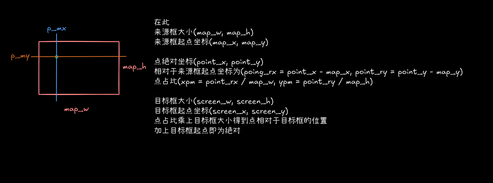

# Point2PoSize(const std::shared_ptr<const Space::Point>& map_point, const Space::Range& map_size, const PoSize& screen_pos, const PoSize& screen_size,  const std::shared_ptr<const Space::Point>& point);
该函数用于将`xII::Space::Point`转换为`xII::Screen::PoSize`  
```C++
PoSize Point2PoSize(const std::shared_ptr<const Space::Point>& map_point, const Space::Range& map_size,
                    const PoSize& screen_pos, const PoSize& screen_size,
                    const std::shared_ptr<const Space::Point>& point);
```
需要传入几个信息
- 来源框 `map_point`和`map_size`  
- 目标框 `screen_pos`和`screen_size`  
- 点 `point`  

他将返回`point`在`screen`中的位置
## 原理
利用坐标变换方法
