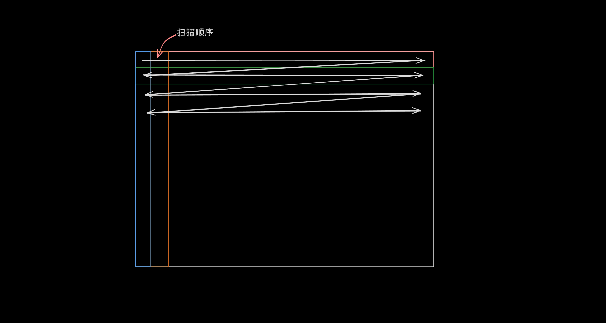

# xII::Screen::RGBA8888
> [!WARNING]
> 该class不完善，后续可能有变化

该class定义于`src/Screen/RGBA8888.h`  
## 元素
### Pixel
该类中的一个结构体，用于存储像素  
```C++
struct Pixel {
    uint8_t A, R, G, B;
};
```
### _data *(private)*
指向数据的指针
```C++
Pixel* _data = nullptr;
```
> [!WARNING]
> 当前版本可能会导致野指针  
> 后续可能更换为`std::shared_ptr<Pixel>`类型
### _size *(private)*
存储画布大小的数组
```C++
PoSize _size{0, 0};
```
### 构建 析构
#### 使用画布大小构建
传入`xII::Screen::PoSize`即可构建指定大小的画布
```C++
explicit RGBA8888(const PoSize& size);
```
> [!WARNING]
> 请不要传入负值的大小，该构建中不会判断size的合法性
#### 左值构建
利用一个已有画布进行拷贝
```C++
RGBA8888(const RGBA8888& s);
```
> [!WARNING]
> 此操作会进行值复制，请确保你所要干的就是它
#### 右值构建
利用已有画布右值进行转移  
```C++
RGBA8888(RGBA8888 &&s) noexcept;
```
`s._size`将设为`{0, 0}`  
`s._data`将设为`nullptr`
#### 构析
> [!WARNING]
> 该构析方法将释放画布，可能造成野指针
### clear()
用于清除画布，此操作将填充画布为`{255, 0, 0, 0}`
```C++
void clear();
```
### resize(const PoSize& new_size)
用于重新设置画布的大小  
包括分配以及释放旧画布
```C++
void resize(const PoSize& new_size);
```
### fill(const Pixel& pixel)
用于填充画布内容  
```C++
void fill(const Pixel& pixel);
```
### fill(const Pixel& pixel, const PoSize& pos, const PoSize& size)
用于填充画布，但有开始坐标和大小  
```C++
void fill(const Pixel& pixel, const PoSize& pos, const PoSize& size);
```
### set(const PoSize& pos, const Pixel& pixel)
用于设置某个像素
```C++
void set(const PoSize& pos, const Pixel& pixel);
```
### copy(const RGBA8888& src_screen, RGBA8888& dest_screen, const PoSize& src_pos, const PoSize& dest_pos, const PoSize& size)
用于拷贝，包含有目标位置参数
```C++
static void copy(const RGBA8888& src_screen, RGBA8888& dest_screen, const PoSize& src_pos, const PoSize& dest_pos, const PoSize& size);
```
### copy(const RGBA8888& src_screen, RGBA8888& dest_screen)
用于拷贝
```C++
static void copy(const RGBA8888& src_screen, RGBA8888& dest_screen);
```
> [!WARNING]
> 该函数没有检查，超出范围的不复制
### blend_alpha(const RGBA8888& src, RGBA8888& dest)
用于混合
```C++
static void blend_alpha(const RGBA8888& src, RGBA8888& dest);
```
### blend_alpha_pixel(const Pixel& src, const Pixel& dest)
用于混合像素
```C++
static Pixel blend_alpha_pixel(const Pixel& src, const Pixel& dest);
```
### at(const PoSize& pos)
获取像素的引用
```C++
[[nodiscard]] Pixel& at(const PoSize& pos);
```
### at(const PoSize& pos)
获取像素的引用，Read-only
```C++
[[nodiscard]] const Pixel& at(const PoSize& pos) const;
```
### getSize()
返回`_size`的引用
```C++
[[nodiscard]] PoSize& getSize();
```
### getSize()
返回`_size`的引用, Read-only
```C++
[[nodiscard]] const PoSize& getSize() const;
```
### getData() 
用于获取画布的指针
```C++
[[nodiscard]] Pixel* getData();
```
### getData()
用于获取画布的指针, Read-only
```C++
[[nodiscard]] const Pixel* getData() const;
```
### operator=(const RGBA8888& s)
赋值运算
```C++
RGBA8888& operator=(const RGBA8888& s);
```
### operator<<(const RGBA8888& src)
```C++
RGBA8888& operator<<(const RGBA8888& src);
```
## 相关规定
### 扫描顺序
该画布是逐行扫描类型，从左至右增加，从上至下增加  
